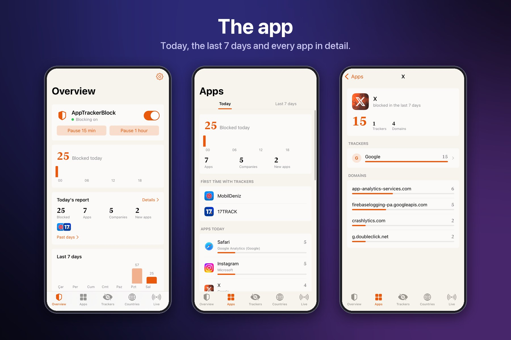

# AppTrackerBlock

Blocks app trackers system-wide, Safari included. Nothing is injected into apps.

## Install

Add `https://muratkurt.github.io/` in Sileo and install **AppTrackerBlock**. Needs PreferenceLoader. CCSupport only for the Control Center button on iOS 15–17.

## Requirements

- iOS 15 or later
- RootHide or rootless

## Features

- **Kernel blocking** — tracker domains are dropped in the network layer, for every app.
- **App** — today, the last 7 days, every app, company and server country, and a live feed.
- **Daily report** — at 21:00: what was blocked and which apps reached trackers for the first time.
- **Quick panel** — from Control Center; pause for 15 minutes or an hour.
- **Widgets** for the home screen, 9 themes, 12 languages.
- **Deep mode** (optional) for apps with their own network code.

Details and changelog: [package page](https://muratkurt.github.io/depictions/com.muratkurt.apptrackerblock.html).

## Bugs

Open an [issue](../../issues/new/choose) with your device, iOS version, jailbreak and AppTrackerBlock version.

## Credits

Blocklist: [HaGeZi Multi PRO](https://github.com/hagezi/dns-blocklists). Company names: DuckDuckGo Tracker Blocklists and Disconnect (CC BY-NC-SA 4.0). IP geolocation by [DB-IP](https://db-ip.com) (CC BY 4.0).

Built with [Claude Code](https://claude.com/claude-code).
